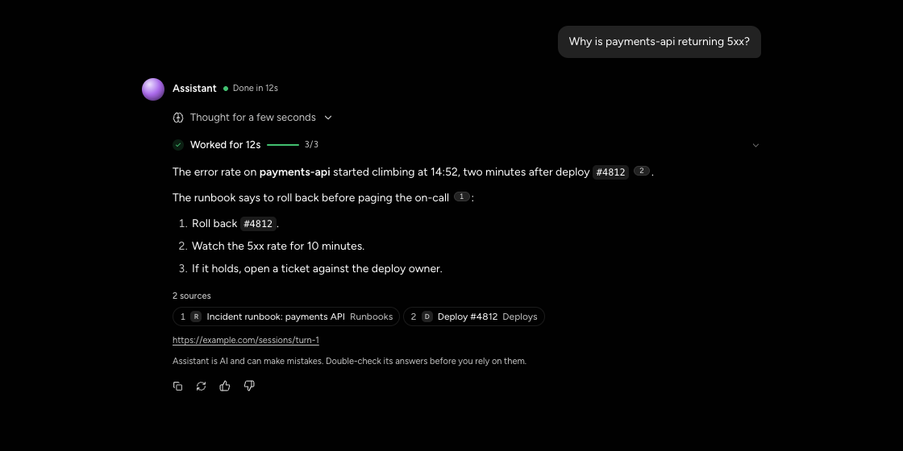

<p align="center">
  <h1 align="center">vultus</h1>
  <p align="center">
    One agent UI model, rendered to the web and to Slack Block Kit from the same React components.
    <br /><br />
    <a href="#installation">Install</a>
    &middot;
    <a href="https://github.com/urmzd/vultus/issues">Report Bug</a>
    &middot;
    <a href="docs/surfaces.md">Surface Map</a>
  </p>
</p>

<p align="center">
  <a href="https://github.com/urmzd/vultus/actions/workflows/ci.yml"></a>
  &nbsp;
  <a href="LICENSE"></a>
</p>

<p align="center">
  <a href="showcase/agent-turn.png"></a>
</p>

> ## Status
>
> **vultus is v0 alpha software.** Nothing is published to npm yet, the
> packages and their APIs will change without notice, and it is not recommended
> for production.

## Features

- **One model.** Turns, tasks, approvals, clarifications, failures, artifacts, inbox items and session state are defined once in `@vultus/core`, with a pure event reducer that any runtime can feed.
- **One component, two renderers.** Shared components are built only from primitives. `render-web` draws them in the DOM, and `render-slack` serializes the same React tree to Block Kit through a custom reconciler.
- **Slack done properly.** The Slack renderer enforces limits, supplies fallback text and time tokens, streams with `chat.startStream`, `appendStream` and `stopStream`, and maps statuses to what Slack accepts. Every fixture is checked against Slack's `blocks.validate`.
- **Human-in-the-loop.** Approval gates, batch approvals, Ask, Always Allow and clarifications, with decisions that update in place. Every gate settles exactly once and never defaults to yes.
- **Web-only extras where Slack has its own UI.** The prompt bar with a message queue, the thinking orb, a statusline for context, compaction and budget, the turn rail and artifact previews.
- **Real Slack sandbox.** Generate the app manifest, then post fixtures, stream turns and click real buttons over Socket Mode.
- **Themeable.** A neutral black base with one swappable accent (purple by default; blue, yellow and teal presets, plus a hue shift), in light or dark.

## Installation

### Prerequisites

| Requirement | Version |
|-------------|---------|
| Node | 22+ |
| pnpm | 11+ |

The packages are private and not published yet. Work from the workspace:

```sh
git clone https://github.com/urmzd/vultus.git
cd vultus
pnpm install --frozen-lockfile
```

## Quick Start

```sh
pnpm storybook
```

Open [Storybook](http://localhost:6006) and select **Agent → Turn states** to inspect completed answers, approvals, failures, and artifacts. The stories use bundled fixtures; starting the web demo requires no Slack account or API keys.

In a second terminal, validate the Slack renderer:

```sh
pnpm sandbox validate
```

This checks fixtures against Slack's `blocks.validate` endpoint and requires network access, but no token. Posting messages and running Socket Mode require a Slack test app; follow the [sandbox setup](apps/slack-sandbox/README.md).

The same event model feeds both renderers:

<!-- fsrc src="examples/basic/render.tsx" fence="auto" -->
```
import { TurnView } from "@vultus/components";
import { replay } from "@vultus/core";
import { renderToSlack } from "@vultus/render-slack";
import { WebSurface } from "@vultus/render-web";

// One stream of events from any runtime...
const turn = replay([
  { type: "turn.started", turnId: "t1", agent: { name: "Assistant" } },
  { type: "task.upserted", task: { id: "s", title: "Searched runbooks", status: "complete" } },
  { type: "text.delta", text: "Roll back deploy `#4812`, then watch the 5xx rate." },
  { type: "turn.completed" },
]);

// ...one component, rendered to the web...
export const Web = () => (
  <WebSurface onAction={(action) => console.log(action.id, action.payload)}>
    <TurnView turn={turn} />
  </WebSurface>
);

// ...and to Slack Block Kit, ready for chat.postMessage.
export const slack = renderToSlack(<TurnView turn={turn} />);
```
<!-- /fsrc -->

## Examples

See [`examples/basic/render.tsx`](examples/basic/render.tsx) for the shared web and Slack rendering example.

The [approval screenshot](showcase/approval.png) shows a turn waiting for a human decision. Recreate both screenshots from the bundled Storybook fixtures with [teasr](https://github.com/urmzd/teasr):

```sh
# Keep pnpm storybook running in another terminal.
teasr run
```

Capture settings live in [`teasr.toml`](teasr.toml).

## Usage

### Web

Wrap shared components in `WebSurface`. Clicks arrive as the same `UiAction` that a Slack interaction decodes to, so one handler serves both surfaces.

### Slack

`renderToSlack(element, { placement })` returns `{ blocks, pages, text, warnings }`, where placement is `message`, `modal` or `home`. For streaming:

1. Pass `streamStart` to `chat.startStream`.
2. Run each `streamUpdate(prev, next)` result through `streamPages`, and send it with `chat.appendStream`.
3. Finish with `chat.stopStream`, using `renderToSlack(<TurnView streamed />)` for the final blocks.

A turn that outgrows one message continues in the next. `streamPages` returns one entry per message: for each entry after the first, append `streamTrailer()`, stop the stream, and start a new one with `streamHeader(turn, { page })`. Code fences and tables are carried across the cut. `pages` does the same for blocks: `pages[0]` is `blocks`, and the rest are follow-up messages. See `apps/slack-sandbox/src/run.tsx`.

`TurnView` closes every message the same way, in every outcome including failures: the references, one context line holding only the session address (`turn.sessionUrl`, or the source's page when there is no session) as a plain link, then the disclaimer, which names the agent ("Assistant is AI…") unless `turn.disclaimer` replaces it. Neither appears at the top, and a long answer carries them on its last message only. `streamHeader` only labels continuation messages ("Part 2").

`lifecycle(turn)` returns the reaction for the user's message and the agent session status. `decodeSlackAction` turns any `block_actions` payload back into a `UiAction`.

### Sandbox

| Command | Does |
|---------|------|
| `pnpm sandbox manifest` | Generate the Slack app manifest from the capabilities vultus uses |
| `pnpm sandbox validate` | `blocks.validate` every fixture |
| `pnpm sandbox post <name\|all>` | Post fixtures to your test channel |
| `pnpm sandbox stream [turn]` | Stream a turn for real |
| `pnpm sandbox upload` | Upload a real file and post its artifact card |
| `pnpm sandbox serve` | Socket Mode: chat with the bot and click real buttons |

See [apps/slack-sandbox/README.md](apps/slack-sandbox/README.md) for setup.

## Architecture

`core` (model, events, queue, session, inbox) feeds `components` (shared, primitives only). The primitives are implemented by `render-web` (DOM) and by `render-slack` (Block Kit). `web` holds the components that only exist on the web.

See [docs/surfaces.md](docs/surfaces.md) for every concept mapped to both surfaces, and for the open questions.

### Go module

`go/` is a separate Go module, `github.com/urmzd/vultus/go`, for a surface that has no React tree: GitHub comments. Its `github` package renders a structured, evidence-backed review and a pull request guide as GitHub Markdown, and escapes model text so a finding cannot inject markup, links or mentions. It takes [mandatum](https://github.com/urmzd/mandatum)'s GitHub connector types as input and is consumed by [collegium](https://github.com/urmzd/collegium). It is versioned with its own tags, in the form `go/vX.Y.Z`.

```sh
go get github.com/urmzd/vultus/go@latest
```

## License

[Apache-2.0](LICENSE)
